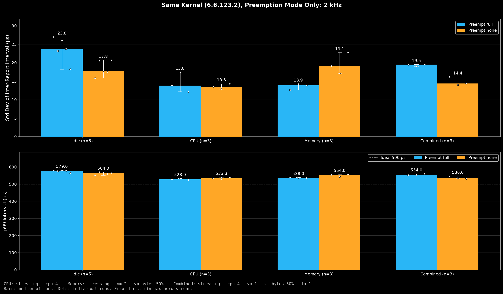
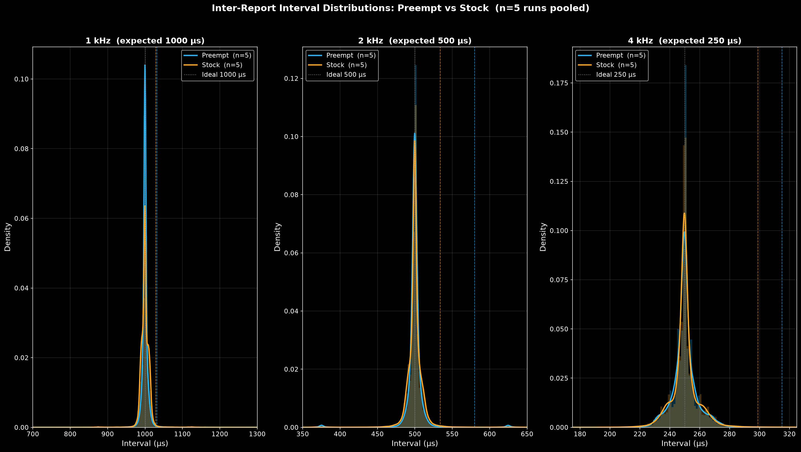
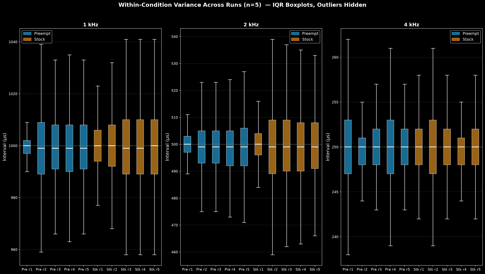
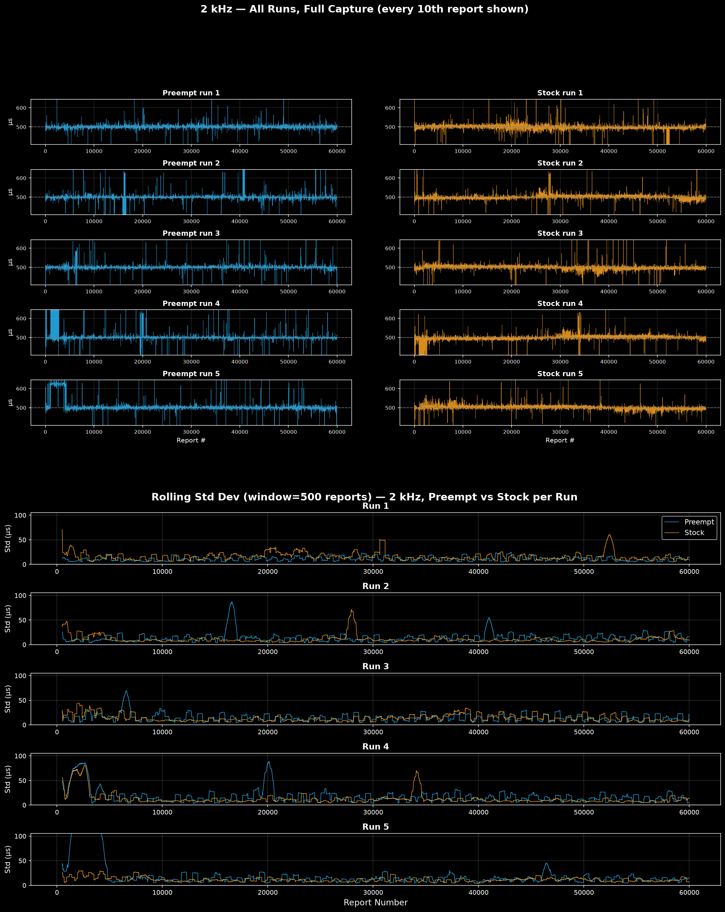
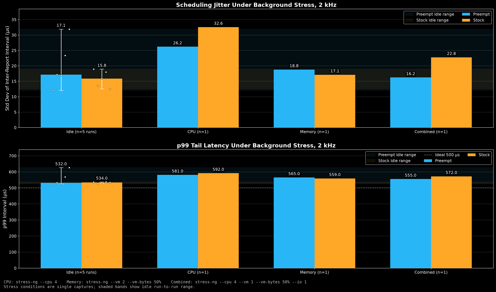

# Mouse Polling Latency: Measuring Host-Side Scheduling Jitter Under WSL2

I booted one WSL2 kernel binary (6.6.123.2) in two dynamic preemption modes, full and none, and measured the spacing between mouse reports at 2 kHz, both idle and under three kinds of stress-ng load. Preemption mode had no consistent effect. Full mode came out ahead under memory stress, none came out ahead under combined stress, and the two overlapped at idle and under CPU stress. With 3 runs per side and many comparisons, I don't claim any of those as real effects. The clearer pattern was that background load made report spacing more regular in both modes, observed with the idle runs always captured first, which I can describe but haven't explained. An earlier comparison between two different kernel versions is kept below as supplementary material.

## The Question

A high polling rate mouse is supposed to send a report at a fixed interval, though the spacing is almost never exact. This project is about where that timing inconsistency comes from, and how much of it the operating system is responsible for.

There are two places the timing can be affected.

**Device-side timing.** The sensor takes its readings on one clock and the USB controller sends reports on another. When those two drift out of sync, reports still leave at the right average rate, but the spacing between them differs. This happens entirely in the firmware, and it is what mouse makers spend engineering effort getting right.

**Host-side timing.** Even when the mouse sends a perfectly spaced report, the operating system does not always process it right away. If the CPU is busy running something else inside the kernel, the report has to wait until the kernel reaches a point where it is allowed to stop and handle it. On a kernel without preemption, background work can hold the CPU longer before that point arrives, which shows up as jitter.

This project isolates and measures host-side timing. Does the kernel's preemption mode change the variance in the spacing between mouse reports?

The deeper version of this problem is the subject of recent research out of Northwestern's CS department on Dispersed Interrupt Polling, which proposes removing hardware interrupts entirely and replacing them with compiler-injected polls spread through the kernel and user code, eliminating the nondeterminism of interrupt handling at its source (NU-CS-2025-36). I was attempting to follow that work while building this. This project takes a smaller, more accessible angle on the same underlying question of interrupt-servicing determinism.

## Hardware and Setup

Testing ran on an **Endgame Gear OP1 8K v2** (Nuvoton M483 MCU, PAW3950 sensor), passed into WSL2 (Ubuntu) from Windows using usbipd-win. The main experiment polled at 2 kHz. The earlier experiment also covered 1 and 4 kHz.

The Windows host was kept clean to reduce noise. The clean install of Windows 11 (AtlasOS) on its own drive kept background activity on the host to a minimum.

Early captures were redone after higher variance was traced to the mouse sharing a USB controller with a keyboard, and all reported data uses an isolated port.

Reports were captured through the kernel's **evdev** interface rather than recording raw USB traffic. With evdev the kernel stamps each report with a timestamp the moment it enters the input subsystem, before any of the Python code runs. The script's own speed therefore cannot distort the spacing between reports. Timestamps use `CLOCK_MONOTONIC` (set via the `EVIOCSCLOCKID` ioctl) so they are immune to wall-clock adjustments.

## The Experiment

### Main design: one kernel binary, two preemption modes

The custom kernel is built with `CONFIG_PREEMPT_DYNAMIC=y`, so the preemption mode is chosen at boot. Full mode is the compiled default (`CONFIG_PREEMPT=y`). None mode is the same binary booted with `preempt=none` on the kernel command line. Because the binary doesn't change, kernel version, build config and drivers are identical in both modes and only the preemption mode differs.

| Condition | Load during capture | Runs per mode |
|---|---|---|
| Idle | none | 5 |
| CPU | `stress-ng --cpu 4` | 3 |
| Memory | `stress-ng --vm 2 --vm-bytes 50%` | 3 |
| Combined | `stress-ng --cpu 4 --vm 1 --vm-bytes 50% --io 1` | 3 |

Each capture is 30 s of continuous slow circular motion at 2 kHz and must have zero `SYN_DROPPED` events. Every capture records the active preemption mode (read from `/sys/kernel/debug/sched/preempt`) and the kernel command line in its metadata, and the analysis refuses any file whose recorded mode doesn't match its filename. Captures were taken with [`capture/run_capture.sh`](capture/run_capture.sh), which starts stress-ng and confirms it is running before the capture begins. Captures that dropped events were re-run, and the rejected files are kept in `data/rejected/`.

The unit of analysis is the run. Each run gets its own std, p99 and p99.9, and the tables report the median and range across runs. Nothing in the main results is pooled across runs.

### Earlier experiment: two different kernel versions

Before the main design, I compared two different kernels at 1, 2 and 4 kHz with 5 idle runs each, plus one stress capture per load type at 2 kHz.

| Condition | Kernel | Preemption |
|---|---|---|
| Preempt | 6.6.123.2-microsoft-standard-WSL2+ (custom build) | `CONFIG_PREEMPT=y` (full) |
| Stock | 6.18.33.1-microsoft-standard-WSL2 | `CONFIG_PREEMPT_NONE=y` |

These kernels differ in version as well as preemption, so any difference between them can't be attributed to preemption alone. The same-binary experiment above was added to remove that confound. The earlier results are in the supplementary section.

## Results



Each bar is the median across runs, each dot is one run, and the error bar spans the lowest to highest run. Look at whether the dots for full and none overlap within each group.

### Per-condition summary

All values are in µs and are computed per run. Δ is the change in median std against that mode's own idle median. Source: [`figures/same_kernel_stats.md`](figures/same_kernel_stats.md).

| Condition | Mode | n | Median std | Std range | Median p99 | p99 range | Median p99.9 | Δ median std vs idle |
|---|---|---:|---:|---:|---:|---:|---:|---:|
| Idle | full | 5 | 23.79 | 18.21–26.98 | 579.0 | 564.0–581.0 | 604.0 | n/a |
| Idle | none | 5 | 17.83 | 15.80–20.69 | 564.0 | 551.0–570.0 | 607.0 | n/a |
| CPU | full | 3 | 13.80 | 12.16–17.45 | 528.0 | 524.0–533.0 | 591.0 | -42.0% |
| CPU | none | 3 | 13.53 | 12.81–14.31 | 533.3 | 530.0–540.0 | 575.0 | -24.1% |
| Memory | full | 3 | 13.86 | 12.64–14.27 | 538.0 | 536.0–539.0 | 584.0 | -41.7% |
| Memory | none | 3 | 19.11 | 17.15–22.71 | 554.0 | 543.0–557.0 | 613.0 | +7.1% |
| Combined | full | 3 | 19.49 | 19.02–19.55 | 554.0 | 553.0–560.0 | 630.0 | -18.1% |
| Combined | none | 3 | 14.37 | 13.99–16.17 | 536.0 | 532.0–546.0 | 597.0 | -19.4% |

### Preemption mode: no consistent effect

Comparing the run values of the two modes:

- **Memory:** every full run was below every none run on both std and p99.
- **Combined:** every none run was below every full run on both std and p99.
- **Idle and CPU:** the runs of the two modes overlapped on std and p99.

The two clean separations point in opposite directions. With 3 runs per side, complete separation happens about 10% of the time by chance alone, and the stats file makes 12 metric comparisons, so a few separations are expected from noise. I don't claim any of these as an effect of preemption mode. The full separation table is in [`figures/same_kernel_stats.md`](figures/same_kernel_stats.md).

### Load reduced jitter

In both modes, the stress runs were usually more regular than the idle runs. Median std was lower than that mode's idle median in 5 of the 6 mode-by-stress combinations. The exception was memory stress in none mode (+7.1%). Median p99 was lower than the idle median in all 6.

In each mode, all idle runs were captured before all stress runs, so the difference between idle and stress is also a difference between earlier and later in the session. Session effects could produce the same pattern, for example the system settling or my hand motion getting steadier. Treat this as a pattern to retest with an interleaved capture order, not an established effect. It does not affect the full vs none comparison, because both modes were captured in the same order.

One hypothesis is that an idle system lets its CPUs drop into deeper idle states, and waking from those states takes time. On top of that, the Windows hypervisor may deschedule a WSL2 vCPU that has nothing to do, so a report arriving at an idle vCPU waits for it to be scheduled again. Background load would keep the vCPUs busy and avoid both delays. This data doesn't test that explanation. The first item in Future Work does.

### Rejected captures

| Mode | Condition | Attempts | Rejects | Reject rate |
|---|---|---:|---:|---:|
| full | Idle | 5 | 0 | 0% |
| full | CPU | 3 | 0 | 0% |
| full | Memory | 3 | 0 | 0% |
| full | Combined | 3 | 0 | 0% |
| none | Idle | 5 | 0 | 0% |
| none | CPU | 4 | 1 | 25% |
| none | Memory | 4 | 1 | 25% |
| none | Combined | 4 | 1 | 25% |

All three rejects came from none mode under stress. A Fisher exact test on stress rejects, full vs none (0/9 vs 3/12), gives a two-sided p = 0.2286. I'm reporting this as observed and not as an effect.

### Warmup check

To check whether startup transients drive any of this, I dropped the first 4,000 intervals (2 s) from every run and recomputed everything. The direction of every std and p99 comparison between modes stayed the same, with one exception: the CPU std medians, which were already nearly tied, swapped order (13.80 vs 13.53 on the full capture, 12.80 vs 13.20 after trimming, full listed first). The memory and combined separations on std and p99 held. The p99.9 separations under CPU, memory and combined stress turned into overlaps after trimming.

## Supplementary: different kernel versions

These results come from the earlier experiment, where the two kernels differ in version as well as preemption mode. An earlier version of this README reported a 2 kHz improvement from the preemptible kernel based on one run per kernel. It did not hold up once five runs were collected.

Pooled across all 5 runs per condition (values in µs, from the stats table printed by `analysis/plot_intervals.py`):

| Condition | Std | p99 | p99.9 | Max |
|---|---:|---:|---:|---:|
| 1 kHz Preempt | 18.924 | 1032.00 | 1164.06 | 2018.00 |
| 1 kHz Stock | 16.755 | 1029.00 | 1136.00 | 2440.00 |
| 2 kHz Preempt | 21.401 | 580.00 | 694.00 | 859.00 |
| 2 kHz Stock | 15.955 | 534.00 | 657.00 | 1462.00 |
| 4 kHz Preempt | 18.423 | 315.00 | 502.00 | 689.00 |
| 4 kHz Stock | 16.964 | 299.00 | 499.00 | 731.00 |

Pooling hides run-to-run spread. At 2 kHz idle, the per-run std ranged from 12.02 to 31.90 for preempt and from 12.50 to 18.93 for stock, and per-run p99 ranged from 524.00 to 626.00 and from 529.00 to 537.00. Both kernels' ranges overlap on both metrics, so at 2 kHz idle the two kernels could not be told apart (source: [`figures/stress_stats.md`](figures/stress_stats.md)).



Pooled interval distributions at each rate. Look at whether the two curves differ in width around the ideal interval.



One box per run. Look at whether the spread between runs of the same kernel is as large as the gap between kernels.



Every 2 kHz run in full, with rolling std below. Look at whether jitter comes in bursts or is spread evenly through the capture.



Single stress captures against the shaded idle range of each kernel. Look at whether a stress bar falls outside its kernel's band.

| Condition | Kernel | n | Std | p99 | Outside idle range? |
|---|---|---:|---:|---:|:---:|
| CPU | Preempt | 1 | 26.20 | 581.00 | no |
| Memory | Preempt | 1 | 18.80 | 565.00 | no |
| Combined | Preempt | 1 | 16.24 | 555.00 | no |
| CPU | Stock | 1 | 32.56 | 592.00 | yes |
| Memory | Stock | 1 | 17.11 | 559.00 | no |
| Combined | Stock | 1 | 22.77 | 572.00 | yes |

Under CPU stress, the stock capture's std (32.56) fell outside stock's idle range while the preempt capture's (26.20) stayed inside preempt's. That suggested stock degrades more under CPU load. It did not replicate on the same binary, where the CPU runs of the two modes overlapped (median std 13.80 full vs 13.53 none). I attribute the earlier result to the kernel version difference or to single-capture noise.

## Limitations

The main experiment runs through usbipd and WSL2, timestamps at evdev rather than on the USB wire, and uses dynamic full preemption rather than PREEMPT_RT. Each stress condition has 3 runs per mode, and all idle runs in each mode were captured before the stress runs, so time in the session is mixed in with condition. The full write-up, including why the kernel version confound no longer applies to the main result, is in [`docs/limitations.md`](docs/limitations.md).

## Repo Structure

```
mouse-polling-latency/
├── docs/
│   ├── methodology.md         experiment design, preemption mode verification, analysis
│   ├── kernel-build.md        preemptible kernel build process
│   └── limitations.md         full limitations write-up
├── kernel/
│   ├── config.txt             preemptible kernel .config
│   └── build-notes.md         build log and notes
├── capture/
│   ├── capture_reports.py     evdev-based capture script
│   ├── run_capture.sh         wrapper: starts stress-ng, verifies it, runs one capture
│   └── requirements.txt
├── data/
│   ├── raw/                   accepted captures (CSV plus .meta.json)
│   └── rejected/              captures discarded for SYN_DROPPED events, kept for the record
├── analysis/
│   └── plot_intervals.py      generates every figure and stats file
└── figures/                   generated figures, same_kernel_stats.md, stress_stats.md
```

## Future Work

- Disable host CPU idle states with `powercfg` on Windows and repeat the idle captures. If idle jitter drops to the level seen under load, that supports the idle-state explanation for the load finding.
- Native Linux capture to remove usbipd and the hypervisor from the path.
- A PREEMPT_RT kernel for a stronger preemption comparison.
- usbmon capture to measure timing inside the USB driver stack, not just at the input-subsystem boundary.
- Interleave capture order across conditions so time in the session isn't tied to condition.
- An open-firmware dev board (nRF52840 + PMW3360 or similar) to measure device-side timing directly, the half of the problem this project does not touch.
